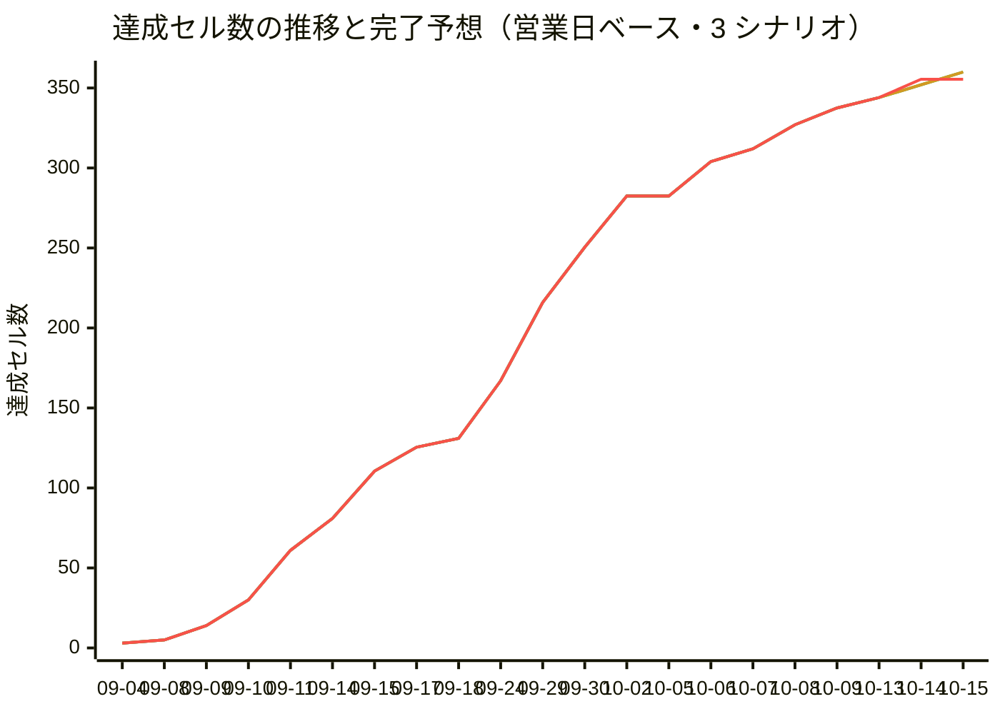

# 進捗一覧

- 生成: 2026-10-13 / `/progress-report`
- 分母: **モックリポジトリ** `../premarket-order-202609`（FastAPI + Jinja2。`python_app/templates/`）
- モック差分: 2026-10-13 まで確認済み / `7ee3ad9`（モックのコミット日 2026-10-12）
- 判定基準: [.claude/skills/progress-report/criteria.md](../.claude/skills/progress-report/criteria.md)

**このファイルは `/progress-report` の出力。** 手で直してもよいが、次の実行で
完了日・更新日・`## 進捗の履歴` 以外は上書きされる。

## モックと開発環境の食い違い（分母はモック）

モックのサイドバーは **4 区分 23 項目**（2026-10-12 に `ユーザ管理マスタ` が増えた）で、`src/components/layout/navigation.js` の
**4 区分 22 項目**と次の差がある。

| 種別 | 対象 |
|---|---|
| モックにあり `navigation.js` に無い | `ユーザ管理マスタ`（`/masters/users`。モック `1797323`・10-12。ルート・view とも未作成）。`仮計算マスタ` は 2026-10-05、`手数料優遇マスタ` は 2026-10-07 に追加済み |
| モックのサイドバーに無いがモックに画面がある | `新規注文`（`/orders/new`）/ `顧客詳細`（`/customers/{id}/summary`・`/customers/{id}/orders`）/ `仮計算`（顧客詳細のタブ）/ 注文の確認・完了・訂正・取消（`/orders/{id}/amend` ほか）/ CSV の確認・完了 |
| `navigation.js` にありモックに無い | なし（`新規注文` は 2026-09-29 にサイドメニューから外した。注文照会などの画面内から遷移する） |
| パスがずれている | 受注不可日マスタ: モック `/masters/blocked-dates` / 実装 `/masters/blackout-dates`（API の命名に合わせた）。約定照会: モック `/executions/` / 実装 `/executions` |

分母から外している 2 区分（`## 認証` / `## レスポンシブ対応`）は 2026-09-17 と同じ理由で外したまま。
サイドメニューの押し出し式開閉は `共通レイアウト / サイドメニュー` に取り込んであるので達成は失われていない。

## モック差分（前回確認以降）

**`fa99f65` → `7ee3ad9`（4 コミット・10-12）。** `pull --ff-only` は Already up to date（ローカルの clone は 10-12 の時点で取り込み済みだった）。
再現は `git -C ../premarket-order-202609 diff --name-status fa99f65 7ee3ad9 -- python_app/templates python_app/routers python_app/mock_data`。

| 変更 | 画面 | モックでの変更内容 | いまの判定 | 対応 |
|---|---|---|---|---|
| 追加 | ユーザ管理マスタ | `base.html` のマスタメンテに項目を追加（`/masters/users?as_user=006`・`can_user_management` のときだけ表示）。Entra ID（メールアドレス）をキーに、キーワードと有効／無効で検索。一覧の「編集」でロールと有効／無効を設定するモーダル（`1797323`） | ❌ | **2 行を追加**（一覧・検索 / 権限設定の編集） |
| 変更 | 権限マスタ | ロール単位の管理に整理。列が 参照・発注・発注（強制）・CSV一括発注・マスタ更新・運用・障害管理・ユーザ管理 の 7 権限になり、「ロール追加」ボタンと、ロール名・説明を含む編集モーダルを足した（`7ee3ad9`） | ✅（既存 2 行） | **ロール追加の 1 行を追加**。既存 2 行は補足に `モック更新あり・追随未確認` |
| 変更 | 注文照会 / 顧客詳細の注文照会タブ | 「強制」ラベルを押すと、発注時に保存した強制理由を中央のモーダルで出す（`063103d` でホバーにしたあと `dafe3a4` でモーダルへ戻した） | ✅ | 注記のみ（追随未確認） |
| 変更 | 新規注文 / 注文訂正 | 強制区分のチェックを `can_force_order`（新しい「発注（強制）」権限）があるときだけ出す。各 1 行の変更 | ✅ | 注記のみ（追随未確認） |

分母は **+3 行 / +12 セル**（104 行 / 348 → 107 行 / 360）。3 行とも未着手なので達成セルは増えない。

10-08 13:05 に検出した `9eeb794` → `fa99f65` の差分は、10-09 午後に新規注文の注文区分・期間指定・預り売買区分（`301a9cd`）、
欄の並び・初期値（`f03c1f8`）、注文訂正のレイアウト（`53f9752`）、特定口座列（`fb14d8c`）、サイドメニューの開閉（`3b610db`）を追随した。
どれも完了済みの行への追随なので、セル数は変わらない。

## 凡例

| 記号 | 意味 | 集計での重み |
|---|---|---|
| `✅` | 完了。シナリオが全て `実装済` で、対応するテストがある | 1.0 |
| `🟡` | 一部のみ。機能の一部だけ実装、またはシナリオの一部が未着手 / 保留 | 0.5 |
| `❌` | 未着手。シナリオ文書もテストも無い | 0 |
| `—` | 対象外。分母から除外する | — |

完了日は `—` を除く 4 軸が全て `✅` になった最初の日。更新日はその後の改修で再び全軸が揃った日。

## 顧客

| 画面 | 機能名 | 実装 | UnitTest | E2E(MSW) | E2E(実API) | 完了日 | 更新日 | 補足 |
|---|---|---|---|---|---|---|---|---|
| 顧客検索 | 検索・結果一覧 | ✅ | ✅ | ✅ | ✅ | 2026-10-02 | - | **モック更新あり・追随未確認**（特定口座列・`a50e5b5`）。`8aca399` / `11e3240`（2026-10-02・`40f5a4f` でマージ）。`/customers/search`（`GET /masters/customers`）。`CSE-01〜16` / `CSW` / `CSS` / `CUA`。実 API `CSER-01〜04` `実装済`（`ea511a6`）。**実 API に接続済み** |
| 預り検索 | 検索・結果一覧 | ✅ | ✅ | ✅ | ✅ | 2026-10-08 | - | `9a35dfc` / `19ae4d1`（2026-10-02・`4b74295` でマージ）。`/customers/holdings`（`GET /holdings`）。`HSE-01〜22` / `HSV` / `HLA`。実 API `HSR-01〜08` `実装済`（`HSR-03/04/08` の保留は 10-08 に #32 の再現手順を流した DB で解除・`9af31b5`） |
| 預り検索 | 直接発注導線（買い / 売り） | ✅ | ✅ | ✅ | ✅ | 2026-10-08 | - | `9a35dfc`。操作列から顧客詳細の注文入力タブへクエリで渡す（`HSE-17〜19`）。売りは売却可能株数を数量に引き継ぐ（`d60ed3d`）。実 API `HSR-09〜11` が 10-08 に `実装済`（#32 の再現手順を流した DB・`9af31b5`） |
| 預り検索 | 仮計算の導線 | ✅ | ✅ | ✅ | ✅ | 2026-10-09 | - | 現地手数料区分の削除（モック `18ed9d1`）は 10-09 に追随（`f950fdc`）。`97d6b13` / `464dd24`（2026-10-06・`a988157` でマージ）。操作列の「仮計算」が `GET /masters/customers` で顧客を引いてから仮計算タブへクエリで渡す。`HSE-23` / `HSV-27〜29` / `CQY`。実 API `HSR-12/13` `実装済`（`b9d5c08` / `4bf828d`・10-09） |
| 顧客詳細 | 資産状況サマリ | ✅ | ✅ | ✅ | ✅ | 2026-10-02 | 2026-10-06 | `8aca399`（2026-10-02）。`/customers/:customerId/summary`。顧客情報バー（`CustomerInfoBar` / `CIB`）と評価額・評価損益（`PFL`）。`CDT-01/02/05〜09/11〜13` / `CDV` / `CSM` / `CDE`。実 API `CDTR-01/03` `実装済`（`ea511a6`・404 の出し分けを含む） |
| 顧客詳細 | 外株預りタブ（保有一覧） | ✅ | ✅ | ✅ | ✅ | 2026-10-02 | 2026-10-08 | `8aca399`。`GET /holdings`（`api/holdings.js` / `HLA`）。CA 発生中の警告（`CCA`）と行の買い / 売り / 新規注文の導線（`CDT-03/04/10/14〜21` / `OEQ`）。実 API `CDTR-01/05〜07` `実装済`（行の買い / 売り `CDTR-05/06` は 10-08 に #32 の再現手順を流した DB で通過・`9af31b5`）。10-07 に一度 `🟡` へ訂正していた |
| 顧客詳細 | 注文入力タブ | ✅ | ✅ | ✅ | ✅ | 2026-10-06 | 2026-10-08 | **10-08 に `CDTR-04` を再検証し `実装済`**（`9af31b5`。10-07 の `63022c1` で期待値が変わり一度 `未着手` に戻っていた）。**モック更新あり・追随未確認**（注文入力の注文区分・ティッカー／銘柄コード・期間指定ほか）。`8aca399`。2026-10-06 に注文入力をタブの中に描く形へ変えた（`bb05fb1`・`/customers/:customerId/order-entry`。部店・口座番号をクエリで引き継ぐ）。`CDT-22/33` / `OEQ` / `NOV`。実 API `CDTR-04` `実装済`（10-05 `ece1e36` で検証済み。前回は「シナリオが無い」と誤って `❌` にしていた） |
| 顧客詳細 | 注文照会タブ | ✅ | ✅ | ✅ | ✅ | 2026-10-02 | 2026-10-06 | 「強制」列（モック `d9b1bd3` / `fa99f65`）は注文照会と同じ `OrderInquiryTable` で `0c48104`（10-08）に追随済み。**モック更新あり・追随未確認**（10-12 の `dafe3a4` で強制理由のモーダル）。`8aca399`。`/customers/:customerId/orders`（`GET /orders` を顧客で絞る）。`CDT-23〜35` / `COV` / `COR` / `OIT`。実 API `CDTR-02` `実装済`（`ea511a6`） |
| 顧客詳細 | 仮計算タブ | ✅ | ✅ | ✅ | 🟡 | - | - | `97d6b13` / `464dd24`（2026-10-06）で見た目、`605542f` / `1703530`（2026-10-07・`b3e9a63` でマージ）で `POST /calculations` に接続（入力検証・4 状態・結果の表示）。`/customers/:customerId/calculations`。`CCV` / `CQY` / `CDT-36〜44` と契約テスト。現地手数料区分の削除（モック `18ed9d1`）は 10-09 に追随（`f950fdc`）。実 API `CDTR-08/10/11` `実装済`・`CDTR-09/12/13` `保留`（実 API の仮計算マスタが未初期化・requests #60 / #61。`4bf828d`）。国内約定日の項目は requests #47 |

## 注文・照会

| 画面 | 機能名 | 実装 | UnitTest | E2E(MSW) | E2E(実API) | 完了日 | 更新日 | 補足 |
|---|---|---|---|---|---|---|---|---|
| 新規注文（外株注文入力） | 注文入力フォーム | ✅ | ✅ | ✅ | ✅ | 2026-10-09 | - | **モック更新あり・一部追随**（ティッカー／銘柄コード両対応は `e931f15` で追随・`NO-35` / `NOS-17` 追加。注文区分 4 区分・期間指定の営業日プルダウン・預り売買区分のトグルは追随未確認）。`3be651e`（2026-09-30）。`/orders/new`。`docs/e2e/order-entry.md` 31 件 `実装済`・`OEV` / `OES` / `OEA` ほか。実 API は入力側の `NR-01/03/04/05` `実装済`（`NR-01` は 10-08 に口座クエリ付きで通過・`99ba62e`。`NR-04` は 10-09 に 2 回続けて通過） |
| 新規注文（外株注文入力） | 注文の送信 | ✅ | ✅ | ✅ | 🟡 | - | - | 同上。確認 → 完了の 2 段階。実 API `NR-02`（事前検証まで・確定しない）と `NR-06`（確定 → 即時取消。試験注文の運用を 10-09 に承認）は 10-09 に `実装済`・`NR-07` `保留`（テスト未作成。規制情報のコード値が未確定）。事前検証が同一口座・銘柄・売買の当日の重複を弾くので、10-09 に入力フォームへ「重複確認区分」のチェックを足した（付けて送り直すと警告に下がる。`NOA-13` / `NOC-14` / `NOV-32` / `NO-38`）。CSV一括に強制区分の列を契約提案として追加（`dbeabf8`） |
| CSV一括注文 | CSV ファイルの取込 | ✅ | ✅ | ✅ | ✅ | 2026-10-08 | - | `1330f47`（2026-09-30）で事前検証を接続し `OC-11/12` の保留を解除。実 API `OCR-01〜03` `実装済`（`OCR-02` の保留は 10-08 に解除・`9af31b5`） |
| CSV一括注文 | 取込内容の確認 | ✅ | ✅ | ✅ | ✅ | 2026-10-08 | - | `1330f47`。`/orders/csv/preview` → `/orders/csv/complete`。`OCP` / `OCC`。実 API `OCR-04〜06` `実装済`（`OCR-05` の保留は 10-08 に解除・`9af31b5`） |
| CSV一括注文 | テンプレートのダウンロード | ✅ | ✅ | ✅ | ✅ | 2026-10-09 | - | 10-09 に `fetchOrderCsvTemplate()` を `arraybuffer` で受ける形に改め（`05b3eed`）、MSW が BOM を落とす問題を解消して `OCA-09` / `OC-10` の保留を外した（`d8c796a`）。`OCA-09〜12`・`OCU-13〜15`・`OC-10`。実 API は `OCR-01` `実装済`（前回まで実装 `🟡`・実 API `❌` と誤って判定していた） |
| 注文照会 | 検索・結果一覧 | ✅ | ✅ | ✅ | ✅ | 2026-10-09 | - | 「強制」列（モック `d9b1bd3` / `fa99f65`）は `0c48104`（10-08）で追随済み。**モック更新あり・追随未確認**（10-12 の `dafe3a4` で「強制」ラベルを押すと強制理由をモーダルで出す）。`f539af3`（2026-09-30）。出来状況の絞り込み・発注権限の出し分け。`OI` 23 件 `実装済`。`TODO(処理実装)`（スライス判定の出所）は `0c48104` で契約提案（requests #57）に置き換えて消えた（前回まで実装 `🟡` のままにしていた）。実 API `OIR-01〜08` `実装済`（`OIR-02` は 10-09 に試験注文を作って即時取消する運用で解除） |
| 注文照会 | 注文訂正 | ✅ | ✅ | ✅ | ✅ | 2026-10-09 | - | **モック更新あり・追随未確認**（読み上げ部品と注文区分）。`f539af3`。`/orders/:id/amend`。`OAM-07/11`・`OAS-12` は `985023f`（10-08 13:10 マージ）で `実装済`。実 API `OIR-09/10/12` `実装済`（`OIR-12` は 10-09 に試験注文で `IN_PLACE` の訂正を確認） |
| 注文照会 | 注文取消 | ✅ | ✅ | ✅ | ✅ | 2026-10-09 | - | `f539af3`。`/orders/:id/cancel`。`OCN` 10 件 `実装済`。実 API `OIR-11`（取消の導線）と `OIR-02`（取消の実行。10-09 に試験注文で 000 → 034 を確認）が `実装済` |
| Dream登録状況 | 検索・一覧 | ✅ | ✅ | ✅ | ✅ | 2026-10-05 | - | `467e11d`（2026-09-29）。`/orders/dream-status`。`DS` / `DSV` / `DSA` / `DSS` / `DEP`。実 API `DSR-01/03〜13` `実装済`（`ece1e36`） |
| Dream登録状況 | STS変更 | ✅ | ✅ | ✅ | 🟡 | - | - | 同上。`581c557` / `7e2e88a`（2026-09-30）で送信まで接続。実 API `DSR-02` `保留`（STS変更可の行が無い） |
| 約定照会 | 検索・結果一覧 | ✅ | ✅ | ✅ | 🟡 | - | - | `f5a2171`（2026-09-28）。`EX` / `EXV` / `EXA` / `EXS`。API は `A`。実 API `EXR-01〜06/08/10` `実装済`（`EXR-02〜06/08/10` は 10-08・`9af31b5`）・`EXR-07`（ページ送り。51 件以上が要る）`未着手` |
| 約定照会 | CSV 出力 | ✅ | ✅ | ✅ | ✅ | 2026-10-08 | - | 2026-09-30（`674dfd4` ほか）。`EX-14〜20`。`GET /executions/export-csv`。実 API `EXR-09/11/12` `実装済`（`EXR-11/12` は 10-08・`9af31b5`） |
| みずほ注文締 | 検索・結果一覧 | ✅ | ✅ | ✅ | 🟡 | - | 2026-10-08 | `a469a0d` / `7496531`（2026-09-28）。`MZ-17` は 10-06 に `実装済`（`status` の複数指定の回答で保留を外した。10-08 に表を訂正）。検索は `GET /executions`。実 API `MZR-01/04〜09/11` `実装済`（`MZR-04〜09/11` は 10-08・`9af31b5`）・`MZR-10`（ページ送り。51 件以上が要る）`未着手` |
| みずほ注文締 | 注文締め・締め解除 | ✅ | ✅ | ✅ | ✅ | 2026-10-05 | - | `75eb153`（2026-09-30）。締め・締め解除・注文ファイル作成。実 API `MZR-02` `実装済`（`665cef5`） |
| みずほ注文締 | CSV 出力 | ✅ | ✅ | ✅ | ✅ | 2026-10-08 | - | `fe5d1d9`（2026-09-30）。`MZ-23〜25`。`GET /executions/export-csv` を使う。実 API `MZR-03` `実装済`（10-08・`9af31b5`） |

## マスタメンテ

| 画面 | 機能名 | 実装 | UnitTest | E2E(MSW) | E2E(実API) | 完了日 | 更新日 | 補足 |
|---|---|---|---|---|---|---|---|---|
| 顧客マスタ | 一覧・検索 | ✅ | ✅ | ✅ | ✅ | 2026-10-05 | - | `CU` / `CLV` / `CUS` / `CUA` / `CDA` / `CDS`。実 API `CUR-01/03〜07` `実装済`（`1a301dd`）。米国株評価額 / 評価損益の列は 2026-09-28 に外した（`cca3016`） |
| 顧客マスタ | 新規登録 | ✅ | ✅ | ✅ | ✅ | 2026-10-07 | - | `cca3016` / `e7223c2`（2026-09-28）。`docs/e2e/customers.md` 22 件すべて `実装済`・`utils/customerFields.js`。実 API `CUR-02` は 10-07 に `実装済`（validate が `valid:true` を返すようになった・`bf11ac4`） |
| 顧客マスタ | 編集 | ✅ | ✅ | ✅ | ✅ | 2026-10-08 | - | 同上。業務キーは読み取り専用。削除の導線はモックに無い。10-09 に法人のとき NISA の 3 項目を無効にした（`aac7dec`）。実 API `CUR-08〜11` は 10-07 に `実装済`、`CUR-12/13`（取消済み口座の再有効化）は 10-08 に `実装済`（#55 の改修後・`784468d`。前回は 14:30 時点で未マージだった）。既存の個人顧客の編集はテストデータの顧客名が半角スペース区切りで事前検証に落ちる（requests #56・待ち） |
| ユーザ管理マスタ | 一覧・検索 | ❌ | ❌ | ❌ | ❌ | - | - | **10-13 に行を追加**（モック `1797323`・10-12）。`navigation.js` に項目なし・ルート未定義。Entra ID（メールアドレス）・氏名・所属部店・ロール・有効／無効の一覧、キーワードと有効／無効で検索。API は `GET /masters/users` |
| ユーザ管理マスタ | 権限設定の編集（ロール・有効／無効） | ❌ | ❌ | ❌ | ❌ | - | - | **10-13 に行を追加**（モック `1797323`）。一覧の「編集」で開くモーダル。API は `PUT /masters/users/{operator_code}`。モックは最後の有効な管理責任者を無効にできないよう守っている |
| 権限マスタ | ロール追加 | ❌ | ❌ | ❌ | ❌ | - | - | **10-13 に行を追加**（モック `7ee3ad9`・10-12 の「ロール追加」ボタンとモーダル）。`openapi.json` に `POST /masters/permissions` が無い（`PUT /masters/permissions/{role_code}` だけ）ため成熟度 `D` |
| 権限マスタ | ロール別権限一覧 | ✅ | ✅ | ✅ | ✅ | 2026-10-05 | - | **モック更新あり・追随未確認**（10-12 の `7ee3ad9` で 7 権限の列に変わった）。2026-09-17 に実装（`3ff4bac`）。単体 `PMA` / `AUA` / `PMS` / `PMV`、E2E `PM-01〜08`。2026-09-25 に仕様の形（`RolePermissionItem`・日本語キー・4 権限）へ張り替えた（`feat/permission-master-save`。requests #4 解消・`KNOWN_GAPS` から外した）。モックの「操作ログ閲覧」「管理者機能」は仕様に無いので列から外した。編集可否は `GET /auth/me` のロールで決める。実 API `PMR-01〜04` `実装済`（`fc5cb4f`） |
| 権限マスタ | 権限の編集・保存 | ✅ | ✅ | ✅ | ✅ | 2026-10-05 | - | **モック更新あり・追随未確認**（`7ee3ad9` でロール名・説明も編集できるモーダルになった）。E2E `PM-09〜16`。2026-09-25 に `PUT /masters/permissions/{role_code}` へ繋いだ（`feat/permission-master-save`）。保存中・失敗（404 / 409）をダイアログに出し、成功はサーバの文言で通知する。実 API `PMR-05〜08` `実装済` |
| 銘柄マスタ | 一覧・検索 | ✅ | ✅ | ✅ | 🟡 | - | - | 実 API `SMR-01/03〜05` `実装済`・`SMR-06`（ページ送り）`未着手`（`e6efdb4`）。`SM-01〜12` / `STV` / `STS` / `STA` / `STT`。実 API E2E のシナリオが未作成。モックが「有効開始時間」を追加（requests #40 に起票）。2026-10-05 に VWAP対象の一括対象外化と銘柄名検索を追加（`c2e768a`・3 軸） |
| 銘柄マスタ | 新規追加 | ✅ | ✅ | ✅ | ✅ | 2026-10-02 | - | 実 API `SMR` `実装済`（`e6efdb4`）。`SM-13〜20` / `STV`。2026-09-15 に実装。実 API E2E のシナリオが未作成 |
| 銘柄マスタ | 編集 | ✅ | ✅ | ✅ | ✅ | 2026-10-02 | - | 実 API `SMR` `実装済`（`e6efdb4`）。`SM-21〜27`。2026-09-16 に実装。主キーは `id`。実 API E2E のシナリオが未作成 |
| 銘柄マスタ | 削除 | ✅ | ✅ | ✅ | ✅ | 2026-10-02 | - | 実 API `SMR` `実装済`（`e6efdb4`）。`SM-30〜34`。2026-09-16 に実装。実 API E2E のシナリオが未作成 |
| 為替マスタ | 現在レートの表示 | ✅ | ✅ | ✅ | ✅ | 2026-10-01 | 2026-10-06 | `fedbe96` / `14ebab9`（2026-09-30）。`/masters/fx`。`FX` / `FXV` / `FXS` / `FXA`。実 API `FXR-01/03`（`443277c`・2026-10-01）。**実 API に接続済み**。**2026-10-05 の源泉レート追加（`a309af2`）で `FXR-01〜08` を `未着手` に戻した**（再検証待ち。完了日は記録として残す）。**2026-10-06 に FXR-01〜08 を実 API で再検証し全件通過（`実装済`）** |
| 為替マスタ | レート更新 | ✅ | ✅ | ✅ | ✅ | 2026-10-01 | 2026-10-06 | 同上。当日レートの更新。実 API `FXR-02/04〜07`（楽観的ロックの 409 を含む）。**`a309af2` で `未着手` に戻した（再検証待ち）**。**2026-10-06 に FXR-01〜08 を実 API で再検証し全件通過（`実装済`）** |
| 為替マスタ | 源泉レートの表示・更新 | ✅ | ✅ | ✅ | ✅ | 2026-10-06 | - | `6b4345a` / `a309af2`（2026-10-05）。モック `7879bd3`（2026-09-29）で追加。公示レートと別カード・別適用日。実 API 側は `FXR-08` を起票済み・**保留**（今日の行に `源泉レート` が無い。requests #34）。**2026-10-06 に FXR-01〜08 を実 API で再検証し全件通過（`実装済`）** |
| 仮計算マスタ | 現在設定の表示 | ✅ | ✅ | ✅ | ✅ | 2026-10-07 | - | `c978dba` / `82396c5`（2026-10-05・`8135834` でマージ）。モック `b9d023e`。`/masters/calculation-settings`。実 API `PCR-01〜06` `実装済`（`7cdf1f5`・`ca49a16` でマージ） |
| 仮計算マスタ | 設定の保存 | ✅ | ✅ | ✅ | ✅ | 2026-10-07 | - | 同上。消費税率のずらし幅を実 API の丸めに合わせた（`7e99562`）。取引所税・スプレッド・現地手数料率・NISA 仮計算用為替上乗せ率を画面内で直接入力して保存 |
| 手数料優遇マスタ | 一覧の表示枠 | ✅ | ✅ | ✅ | ✅ | 2026-10-07 | - | `c5ba1c5` / `3ef4318` / `6744bee`（2026-10-07・`21b658c` でマージ）。`/masters/fee-preferences`（`navigation.js` にも追加）。`FP` ほか・依頼 #11 の追随。実 API スモーク `FPR-01/02` `実装済`（`dbceafd`）。モックは表示枠だけだが、実装は追加・編集まで持つ（行は増やさない） |
| スライス基準マスタ | 現在値の表示 | ✅ | ✅ | ✅ | ✅ | 2026-09-11 | - | `SC-01/02` / `SCV` / `SCS` / `SCR-01/02`。**実 API に接続済み** |
| スライス基準マスタ | 設定の保存 | ✅ | ✅ | ✅ | ✅ | 2026-09-11 | - | `SC-03/04` / `SCR-03〜07`。**実 API に接続済み** |
| CAマスタ | 一覧・検索 | ✅ | ✅ | ✅ | ✅ | 2026-09-25 | - | `CA-01〜10` / `CAV` / `CAS` / `CAA` / `CAT` / `CAR-01・03・04`。**実 API に接続済み** |
| CAマスタ | 新規追加 | ✅ | ✅ | ✅ | ✅ | 2026-09-25 | - | `CA-11〜17` / `CAR-02・05`。**実 API に接続済み** |
| CAマスタ | 編集 | ✅ | ✅ | ✅ | ✅ | 2026-09-25 | - | `CA-18〜21` / `CAR-06〜08`。銘柄コードは読み取り専用（10-06 `df46fd0`）、更新日時による楽観的ロック付き（ISO の合札が実 API に通り、古い合札は 409）。**実 API に接続済み** |
| CAマスタ | 削除 | ✅ | ✅ | ✅ | ✅ | 2026-09-25 | - | `CA-22〜27` / `CAR-09`。論理削除（取消区分）。**実 API に接続済み** |
| 受注不可日マスタ | 一覧・検索 | ✅ | ✅ | ✅ | ✅ | 2026-09-11 | - | `BD-01〜10` / `BDL` / `BDS` / `BDR-01〜03`。**実 API に接続済み**。**モックが期間登録を日付 1 件ごとに変更（追随未確認・`61c456b`）** |
| 受注不可日マスタ | 新規追加 | ✅ | ✅ | ✅ | ✅ | 2026-09-11 | 2026-09-25 | `BD-11〜18` / `BDR-04/05/09`。2026-09-25 に行 ID のパスキーへ追随し保留を解除（`358e9f3` / `4dfe7bb`）。モック更新あり・追随未確認 |
| 受注不可日マスタ | 編集 | ✅ | ✅ | ✅ | ✅ | 2026-10-07 | - | `BD-24〜30`。実 API `BDR-07`（日付の変更）を 10-07 に `実装済`（`810a3ed` / `bf11ac4`。日付の上書きがバックエンドで直った） |
| 受注不可日マスタ | 削除 | ✅ | ✅ | ✅ | ✅ | 2026-09-11 | 2026-09-25 | `BD-19〜23` / `BDR-08`。2026-09-25 に保留を解除 |
| 海外休場日マスタ | 一覧・検索 | ✅ | ✅ | ✅ | ✅ | 2026-09-10 | - | `MH-01〜07/17〜21` / `MR-01〜03` / `MHT`。**実 API に接続済み**。モックの「短縮取引日」の見せかた（`a164927`）と検索日付の 1 欄化（`932c377`）は 10-06 に追随。期間登録の日付 1 件化は追随未確認 |
| 海外休場日マスタ | 新規追加（再有効化を含む） | ✅ | ✅ | ✅ | ✅ | 2026-09-10 | 2026-09-25 | `MH-08〜11/22/23` / `MR-04/05/07/08`。`docs/e2e/market-holidays-real-api.md` 8 件すべて `実装済`。モック更新あり・追随未確認 |
| 海外休場日マスタ | 削除 | ✅ | ✅ | ✅ | ✅ | 2026-09-10 | 2026-09-25 | `MH-12〜16` / `MR-06` |
| 残高マスタ | 保有残高の一覧・検索 | ✅ | ✅ | ✅ | 🟡 | - | - | `BA-01〜10` / `BLV-01〜13` / `BLA-01〜12`。検索の銘柄名は 10-07 に `symbol_name_ja` へ送り替えて実 API で効く（requests #13 解消・`BAR-07`）。モックが「成長投資枠」を追加（追随未確認）。実 API `BAR-01/03/04/06/07` `実装済`（`BAR-07` の銘柄名検索は 10-08 に通過・`10e3f4a`）・`BAR-05` `保留`・`BAR-08` `未着手`（`06f7495`。`BAR-05` は 10-08 の検証で `保留` に戻った・`9af31b5`） |
| 残高マスタ | 残高を補正（数量の加算） | ✅ | ✅ | ✅ | ✅ | 2026-10-05 | - | `BA-11〜18` / `BLV-14〜26` / `BLA-16〜18`。確認 → 確定の 2 段階。送るのは補正後の絶対値。実 API `BAR-10〜12` `実装済` |
| 残高マスタ | 新規保有を追加 | ✅ | ✅ | ✅ | 🟡 | - | - | `BA-19〜27` / `BLV-27〜35` / `BLA-13〜15`。顧客・ティッカー・銘柄名・口座区分・加算数量を指定。実 API `BAR-09` `実装済`・`BAR-13` `保留` |
| 残高マスタ | 売却不可区分の切替 | ✅ | ✅ | ✅ | ✅ | 2026-10-05 | - | `BA-28〜33` / `BLV-36〜43` / `BLA-19〜21`。2026-09-25 に専用の `PUT .../{balance_id}/sell-prohibited` へ張り替えた（`768cb5d`）。実 API `BAR-02` `実装済` |

## 運用管理

モックのサイドバーにある区分。**`navigation.js` に 4 項目がそろい、4 画面とも `main` に入った**
（滞留注文抽出は 2026-09-24 に `13db964` でマージ）。

| 画面 | 機能名 | 実装 | UnitTest | E2E(MSW) | E2E(実API) | 完了日 | 更新日 | 補足 |
|---|---|---|---|---|---|---|---|---|
| お知らせ管理 | お知らせの更新（表示切替・本文） | ✅ | ✅ | ✅ | ✅ | 2026-09-30 | 2026-09-24 | `AN-01〜13/16〜18` / `ANA` / `ANS` / `ANV` / `BNA` / `BTX`。実 API スモーク `ANR-01/02` `実装済` |
| お知らせ管理 | 更新履歴 | ✅ | ✅ | ✅ | ✅ | 2026-10-09 | - | `AN-04/05/14/15` / `ANS` / `ANV`。操作区分名のバッジ・`limit` / `offset` のページング。10-09 に操作者の氏名を出した（`5e6acbe`・requests #48）。実 API `ANR-05` は 10-09 に履歴を 55 件まで積んで `実装済` |
| 滞留注文抽出 | 検索・一覧 | ✅ | ✅ | ✅ | ✅ | 2026-10-09 | 2026-10-09 | `/operations/stalled-orders` / `StalledOrderListView.vue`。`SO-01〜10/13/14` / `SOA` `SOS` `SOV` `SOC` `SOT`。一覧は requests #1① が 09-30 に「`GET /orders` を拡張」で決着済み（`?status=101,003`）。**10-08 に `src/api/stalledOrders.js` を `GET /orders` の 2 回呼び（`101,103` / `003`）へ書き直し**、MSW の専用ハンドラと `KNOWN_GAPS` の行を外した。**10-09 に実 API で `SOR-01` を通した**。`確認状況` だけ #1② 待ち |
| 滞留注文抽出 | 滞留注文の CSV 出力 | ✅ | ✅ | ✅ | — | 2026-09-28 | 2026-10-08 | `5205251`。フロントで組み立て（`utils/stalledOrderCsv.js`）。`SO-17〜19` / `SOV` / CSV の単体。**10-08 に実 API の軸を対象外にした**（フロントで組み立て・API を呼ばない） |
| 滞留注文抽出 | TWS投入CSV サンプルのダウンロード | ✅ | ✅ | ✅ | — | 2026-09-28 | 2026-10-08 | `5205251`。`SO-15` / CSV の単体。**10-08 に実 API の軸を対象外にした**（フロントで組み立て・API を呼ばない） |
| 滞留注文抽出 | コンファメーションCSV の取込 | ✅ | ✅ | ✅ | ✅ | 2026-10-09 | 2026-10-09 | `1830b3d`。10-07 の取り込みで `POST /operations/stalled-orders/confirmation-import` が提案どおり仕様に入った（`01b5d04`・`KNOWN_GAPS` から外した）。**10-09 に実 API で `SOR-02` を通した**（存在しない注文 ID は 200 の行エラー・全行取消）。`SO-20〜24` / `SOA` / `SOS` / `SOV` |
| 滞留注文抽出 | コンファメーションCSV サンプルのダウンロード | ✅ | ✅ | ✅ | — | 2026-09-28 | 2026-10-08 | `5205251`。`SO-16` / CSV の単体。**10-08 に実 API の軸を対象外にした**（フロントで組み立て・API を呼ばない） |
| 操作ログ | 一覧・検索 | ✅ | ✅ | ✅ | ✅ | 2026-09-30 | - | 2026-09-24 に `ActivityLogItem` の形へ張り替え。単体 `ALV` `ALS` `ALT` `ALU` `ALD`・E2E `AL`・実 API `ALR-01/02` |
| 障害管理 | IB送信制御 | ✅ | ✅ | ✅ | ✅ | 2026-09-30 | 2026-10-06 | 実仕様（`/operations/order-suspensions` の停止・再開）に合わせて実装。モックの 2 区画は捨て、**停止対象（`ALL` + ルート 5 種）の表**にした。この行は IB（`'1'`）ほかルート行の停止・再開。`IN-07/13〜19/21〜23` / `INA` / `INS` / `IND` / `INV` / `SUS`。実 API `IR-01/02/06/07`（`443277c`・2026-10-01。別経路の更新と 409・停止時の記録の再開確認まで）。2026-09-25 にモック `08986d1` 追随（操作をスライド式トグル `BaseSwitch` に、確定まで切り替えない。`IN-24` / `INV-22` / `BSW`）。2026-10-01 に停止対象を表からモックと同じカード表示へ（`ce4d246`）。2026-10-06 に運用状態の枠と履歴の表示をモックに揃えた（`ee0a6f8`） |
| 障害管理 | 注文入力制御 | ✅ | ✅ | ✅ | ✅ | 2026-10-05 | 2026-10-06 | 全体（`ALL`）の停止・再開にあたる（新規受付・取消も止まる）。`IN-04/06/12/20/23`。実 API は `IR-03`（現在の運用状態と全体停止中の抑止が API のフラグどおり）で表示側だけ確認。全体行の停止・再開は `IR-08/09` で検証済み（`3d8f0f8`・2026-10-05）。全体停止中はルート行の操作を塞ぐ（仕様は問合せ中・requests #14）。2026-09-25 にモック `08986d1` 追随（全体行もトグル。見出し「障害時の運用制御」） |
| 障害管理 | 障害対応履歴 | ✅ | ✅ | ✅ | ✅ | 2026-10-01 | 2026-10-06 | 停止・再開の操作履歴（`/operations/order-suspensions/history`・`limit=50`）。実 API `IR-04/05`（各列の一致と 2 ページ目。`443277c`）。`変更前 / 変更後` は仕様の型が any のため出さない（requests #15）。`IN-08/09/16`。2026-09-25 にモック `08986d1` 追随（変更日時 / 制御内容 / 停止理由 / 更新者 の 4 列。停止理由はモックに無い意図的なずれ） |

## 共通基盤

画面を持たない区分。画面列には区分名を入れている。

| 画面 | 機能名 | 実装 | UnitTest | E2E(MSW) | E2E(実API) | 完了日 | 更新日 | 補足 |
|---|---|---|---|---|---|---|---|---|
| 共通レイアウト | サイドメニュー | ✅ | ✅ | ✅ | — | 2026-09-09 | 2026-09-16 | `LAY-01/03〜09` / `ASB` / `UST`。押し出し式の開閉を 2026-09-16 に追加。モック更新あり（区分の開閉式・見出し左の三本線で全体を開閉 `bde4ae4`）・追随未確認 |
| 共通レイアウト | ヘッダの画面見出し | ✅ | ✅ | ✅ | — | 2026-09-09 | - | `LAY-02` / `AHD`。`router` の `meta.title` 由来 |
| 共通レイアウト | 市場ステータス表示 | ✅ | ✅ | ✅ | — | 2026-09-09 | 2026-09-18 | `AHD` / `MKS` / `UMS` / `MSA` / `MSS`。判定の出所を `GET /market-status` に移した |
| 共通レイアウト | 市場取引時間の表示 | ✅ | ✅ | ✅ | — | 2026-09-18 | 2026-09-18 | ヘッダに 3 セッション × JST / ET の時間帯グリッド。休場・短縮取引・取得失敗を出し分ける。要件指示（モック外） |
| アクセス制御 | 権限によるアクセス制限 | ✅ | ✅ | ✅ | ✅ | 2026-10-05 | - | `b22d312` / `610903d` / `b6a1942`（2026-09-28）、`850bb11`（09-29・`VITE_USER_CODE` で操作者切替）。`AC` / `RPG` / `CUO` ほか。実 API `ACR-01〜04` `実装済`（`ece1e36`・10-05）。**前回まで「スモーク未作成」と誤って `❌` にしていた**（10-08 に訂正）。要件指示（モック外） |
| 共通レイアウト | 読み込みオーバーレイ | ✅ | ✅ | ✅ | — | 2026-09-17 | - | `AppLoadingOverlay.vue` / `ALO` / `LAY-10〜12` |
| 共通レイアウト | 運用バナー（お知らせ・発注停止） | ✅ | ✅ | ✅ | — | 2026-10-09 | - | **10-09 に行を追加**（モック `base.html` の `.operation-banner`・09-01 からあった見落とし）。`d787d33` / `a80d2c4`（`e099100` でマージ）。全画面のヘッダ直下に帯を出す。`AppOperationBanner.vue` / `useOperationBanner` / `utils/operationBanner.js`。単体 `UOB` / `AOB` / `OBU`・E2E `layout.md` / `announcements.md`。実 API の軸は他のレイアウト行と同じく対象外（お知らせ管理の実 API で API 側は確認済み） |
| 共通レイアウト | サイドメニューのエラー件数 | ✅ | ✅ | ✅ | — | 2026-10-09 | - | **10-09 に行を追加**（モック `base.html` の `.sidebar-failure-badge`・09-02 からあった見落とし）。`a434ef5`（`82635be` でマージ）。注文照会・Dream登録状況の項目に注文エラー / Dream登録エラーの件数を出す。`stores/navBadges.js`・単体 `ASB` / `NBS` ほか・E2E `layout.md` / `dream-status.md`。実 API の軸は他のレイアウト行と同じく対象外 |
| UI 部品 | `components/ui/` の 15 部品 | ✅ | ✅ | ✅ | — | 2026-09-04 | 2026-09-16 | 15 本すべてに spec と `docs/unit/` があり 4 軸の状態が同じなので 1 行に畳んである |
| マスタ共通部品 | 検索カード（`MasterSearchCard`） | ✅ | ✅ | — | — | 2026-09-17 | - | `MSC` |
| マスタ共通部品 | 一覧カード（`MasterListCard`） | ✅ | ✅ | — | — | 2026-09-17 | - | `MLC` |
| マスタ共通部品 | 追加・編集ダイアログ（`MasterFormDialog`） | ✅ | ✅ | — | — | 2026-09-17 | - | `MFD` |
| マスタ共通部品 | 削除確認（`ConfirmDeleteDialog`） | ✅ | ✅ | — | — | 2026-09-17 | - | `CDD-01〜13` |
| 共通ロジック | `useAsync` | ✅ | ✅ | — | — | 2026-09-14 | - | `UAS-01〜17` |
| 共通ロジック | `useCrudList` | ✅ | ✅ | — | — | 2026-09-14 | - | `UCL-01〜43`。受注不可日・海外休場日・CA・銘柄の 4 画面で共用 |
| 共通ロジック | `useListQuery` | ✅ | ✅ | — | — | 2026-09-14 | - | `ULQ-01〜19`。URL クエリと一覧状態の同期 |
| 共通ロジック | `useMarketStatus` | ✅ | ✅ | — | — | 2026-09-15 | - | `UMS-01〜07` |
| 共通ロジック | `useSidebarToggle` | ✅ | ✅ | — | — | 2026-09-16 | - | `UST-01〜07`。開閉状態の保持 |
| ユーティリティ | `utils/format.js` | ✅ | ✅ | — | — | 2026-09-14 | - | `FMT-01〜11` |
| ユーティリティ | `utils/marketStatus.js` | ✅ | ✅ | — | — | 2026-09-08 | - | `MKS-01〜13` |
| ユーティリティ | `utils/queryParams.js` | ✅ | ✅ | — | — | 2026-09-11 | - | `QRY-01〜08` |
| ユーティリティ | `utils/marketHolidayTypes.js` | ✅ | ✅ | — | — | 2026-09-10 | - | `MHT-01〜07` |
| ユーティリティ | `utils/caTypes.js` | ✅ | ✅ | — | — | 2026-09-11 | - | `CAT` |
| ユーティリティ | `utils/symbolTypes.js` | ✅ | ✅ | — | — | 2026-09-14 | - | `STT-01〜05` |
| ユーティリティ | `utils/apiEnums.js` | ✅ | ✅ | — | — | 2026-09-15 | - | OpenAPI の区分値 21 種の写し。`openapi.json` と突き合わせるテスト付き |
| API クライアント層 | `api/client.js` | ✅ | ✅ | — | — | 2026-09-14 | - | `CLA-01〜16`。`normalizeError` を含む |
| API クライアント層 | `api/orders.js` | ✅ | ✅ | — | — | 2026-09-14 | - | `ORA-01〜10`。`toOrder()` の変換を担保 |
| API クライアント層 | `api/blackoutDates.js` | ✅ | ✅ | — | — | 2026-09-11 | - | `BDA` |
| API クライアント層 | `api/sliceCriteria.js` | ✅ | ✅ | — | — | 2026-09-11 | - | `SCA` |
| API クライアント層 | `api/marketHolidays.js` | ✅ | ✅ | — | — | 2026-09-10 | - | `MHA` |
| API クライアント層 | `api/ca.js` | ✅ | ✅ | — | — | 2026-09-11 | - | `CAA` |
| API クライアント層 | `api/codes.js` | ✅ | ✅ | — | — | 2026-09-14 | - | `CDA-01〜07` |
| API クライアント層 | `api/customers.js` | ✅ | ✅ | — | — | 2026-09-14 | - | `CUA-01〜14` |
| API クライアント層 | `api/symbols.js` | ✅ | ✅ | — | — | 2026-09-14 | 2026-09-16 | `STA-01〜12`。`symbol` クエリ名と `id` 主キーへの追随を含む |
| API クライアント層 | `api/permissions.js` | ✅ | ✅ | — | — | 2026-09-25 | - | `PMA`（`0ef423c`） |
| API クライアント層 | `api/activityLogs.js` | ✅ | ✅ | — | — | 2026-09-24 | - | `ALA` |
| MSW モック基盤 | handlers / fixtures | ✅ | — | — | — | 2026-09-11 | 2026-09-16 | ブラウザ・単体・E2E で共用。単体・E2E の直接の対象ではないため `—` で、実装のみで完了とみなす |

2026-09-18 以降に増えた `api/*.js`（お知らせ・バナー・障害管理・残高・市場ステータス・滞留注文）と
`utils/*.js`（`activityLogTypes` / `suspensionState` ほか）は、**各画面の行の UnitTest に数えている**
（補足列の `ANA` / `BNA` / `INA` / `BLA` / `MSA` / `ALT` / `SUS`）。共通基盤に別行を立てると二重計上になる。

## 対象外の画面（集計に含めない）

**モックに無い画面。納品対象ではないので進捗の分母から外す。**

| 画面 | 機能名 | 実装 | UnitTest | E2E(MSW) | E2E(実API) | 完了日 | 更新日 | 補足 |
|---|---|---|---|---|---|---|---|---|
| UI カタログ（`/dev/ui-catalog`） | 部品の一覧表示 | ✅ | ❌ | ✅ | — | - | - | 開発用ページ（業務画面ではない）のため対象外。`UC-01/02` |

## 集計

**進捗は行ではなく「行 × 軸のセル」で数える。**

- **有効セル** = その行の 4 軸のうち `—`（対象外）でないセルの数
- **達成セル** = `✅` 1.0 + `🟡` 0.5（`❌` は 0）
- **残セル** = 有効セル − 達成セル、**進捗率** = 達成セル ÷ 有効セル
- **完了行** = `—` を除く全軸が `✅` の行

「対象外の画面」の 2 行は行ごと数えない。

| 区分 | 行数 | 実装 `✅` | UnitTest `✅` | E2E(MSW) `✅` | E2E(実API) `✅` | 有効セル | 達成セル | 残セル | 進捗率 | 完了行 |
|---|---|---|---|---|---|---|---|---|---|---|
| 顧客 | 9 | 9 | 9 | 9 | 8 | 36 | 35.5 | 0.5 | 99% | 8 |
| 注文・照会 | 15 | 15 | 15 | 15 | 11 | 60 | 58.0 | 2.0 | 97% | 11 |
| マスタメンテ | 35 | 32 | 32 | 32 | 29 | 140 | 126.5 | 13.5 | 90% | 29 |
| 運用管理 | 11 | 11 | 11 | 11 | 8 | 41 | 41.0 | 0.0 | 100% | 11 |
| 共通基盤 | 37 | 37 | 36 | 9 | 1 | 83 | 83.0 | 0.0 | 100% | 37 |
| **合計** | **107** | **104** | **103** | **76** | **57** | **360** | **344.0** | **16.0** | **96%** | **96** |

軸ごとの進捗率。**分母はその軸が `—` の行を除いた数**、`達成` = `✅` + 0.5 × `🟡`。

| 軸 | 分母 | `✅` | `🟡` | 達成 | 残 | 進捗率 |
|---|---|---|---|---|---|---|
| 実装 | 107 | 104 | 0 | 104.0 | 3.0 | 97% |
| UnitTest | 106 | 103 | 0 | 103.0 | 3.0 | 97% |
| E2E(MSW) | 79 | 76 | 0 | 76.0 | 3.0 | 96% |
| E2E(実API) | 68 | 57 | 8 | 61.0 | 7.0 | 90% |

4 軸の分母の和 = 107 + 106 + 79 + 68 = 360、達成の和 = 104.0 + 103.0 + 76.0 + 61.0 = 344.0。
**10-13 は分母 +3 行 / +12 セル、達成は ±0**: モック `1797323` / `7ee3ad9`（10-12）のユーザ管理マスタ 2 行と権限マスタのロール追加 1 行（いずれも 4 軸 `❌`）。
10-09 14:30 以降のマージ（重複確認区分・新規注文 / 注文訂正のモック追随・特定口座列・サイドメニューの開閉）は完了済みの行の追随でセル不変。
`check:scenarios` は error 0（warning は `BAR-13` / `DSR-02` / `NR-07` の「保留」でテスト未作成の 3 件・前回と同じ）。
以下は 10-09 時点の記述。
**10-09 夕方の手修正で +2.0**（同じく手修正）: 試験注文を作って即時取消する運用の承認で、注文照会の 3 行（`OIR-02/12`）と
お知らせ管理の更新履歴（`ANR-05`。履歴を 55 件まで積んだ）の実 API が `✅`（+0.5 × 4）。新規注文の送信は `NR-06` が通ったが `NR-07` の保留で `🟡` のまま。
**10-09 午後の手修正で +4.5**（`/progress-report` の再実行ではない。`## 進捗の履歴` と予想は次の実行で更新する）:
CSV一括注文のテンプレートDL 4 軸（+3.0。うち実装・実 API の 1.0 は前回の誤判定の訂正）・新規注文の実 API `NR-02/04`（+1.0）・
注文照会の検索の実装（+0.5。`TODO` は 10-08 の `0c48104` で消えていた訂正）。
**10-09 は +10.5（うち分母の追加 2 行ぶん +6.0）**: 共通レイアウトに 2 行追加（運用バナー・サイドメニューのエラー件数。3 軸 ✅ で +6.0）・
滞留注文抽出の実 API 2 行（`SOR-01/02`・+2.0。表は `08fff71` で更新済みだったが集計が未反映）・
預り検索の仮計算導線の実 API（`HSR-12/13`・+1.0）・顧客詳細の仮計算タブの実 API（`CDTR-08/10/11`・+0.5）・
新規注文の入力フォームの実 API（`NR-01/03/05`・+0.5）・顧客マスタ編集の実 API（`CUR-12/13`・+0.5）。
以下は 10-08 時点の記述。
**10-08 14:30 の再実行で +1.0**: `985023f`（13:10 マージ・注文訂正の `OAM-07/11`・`OAS-12` を実装済）で注文訂正の UnitTest / E2E(MSW) が `🟡` → `✅`。
`e931f15`（13:30 マージ・注文入力のティッカー／銘柄コード両対応）は `✅` 行の追随でセルは不変。
**10-08 13:05 の再実行で +5.5**: `9af31b5`（10:27 マージ・#32 の再現手順を流した DB での検証モード）が前回の集計に入っていなかった。
顧客 +3.0（預り検索 2 行・外株預りタブ・注文入力タブ）、注文・照会 +2.5（CSV一括の取込・確認・約定 CSV・みずほ CSV）。
残高マスタの一覧は `BAR-05` が `保留` に戻ったが、もとから `🟡` なのでセルは不変。

## 残作業の内訳

成熟度は `A` 確定 / `B` 型のみ / `C` 中身が未定義 / `D` パス無し / `—` API 不要。
`C` `D`・要件未確定・`## バックエンド待ち` に載っている行が**ブロック残**。

**仮定系の類型は 0 のまま**（全類型を 1 本以上作り終えている）。

| 画面 / 機能 | 残セル | 類型 | 根拠 | 成熟度 | 引き当てたパス | ブロック理由 |
|---|---|---|---|---|---|---|
| 顧客詳細 / 仮計算タブの実 API（`CDTR-09/12/13`） | 0.5 | 実API追加 | 実測 | B | `POST /calculations` | **バックエンド待ち**（実 API の仮計算マスタが未初期化・requests #60 / #61） |
| 新規注文 / 送信 `NR-07` | 0.5 | 実API追加 | 実測 | B | `POST /orders` | - （`NR-07` は規制情報のコード値が未確定） |
| Dream登録状況 / STS変更の `DSR-02` | 0.5 | 実API追加 | 実測 | B | `/orders/dream-status/{order_id}` | - |
| 約定照会 / 検索のページ送り（`EXR-07`） | 0.5 | 実API追加 | 実測 | A | `GET /executions` | - （約定 51 件以上が要る） |
| みずほ注文締 / 検索のページ送り（`MZR-10`） | 0.5 | 実API追加 | 実測 | A | `GET /executions` | - （みずほ約定 51 件以上の投入待ち・#32 ②） |
| 銘柄マスタ / 一覧のページ送りの実 API E2E（`SMR-06`） | 0.5 | 実API追加 | 実測 | A | `/masters/symbols` | - |
| 残高マスタ / 一覧（`BAR-05/08`）・新規保有（`BAR-13`）の実 API 残り | 1.0 | 実API追加 | 実測 | A | `/masters/balance-adjustments` 配下 | - |
| ユーザ管理マスタ / 一覧・検索 | 4.0 | CRUDマスタ | 実測 | A | `GET /masters/users` | - （10-13 に追加。`checklist.md` に仕様ギャップの記載なし） |
| ユーザ管理マスタ / 権限設定の編集 | 4.0 | CRUDマスタ | 実測 | A | `PUT /masters/users/{operator_code}` | - （10-13 に追加） |
| 権限マスタ / ロール追加 | 4.0 | CRUDマスタ | 実測 | D | なし（`POST /masters/permissions` が無い。`/masters/permissions` は `GET` だけ） | **パス無し**（ロールを足す API が無い。モックの 7 権限の列と仕様の 4 権限の差もあわせて要確認） |

### 2 通りの割り方

どちらの合計も `## 集計` の残セル **16.0** と一致する（10-09 の 4.0 に、10-13 の分母追加 12.0 を足した）。

| 割り方 | 内訳 | セル | 割合 |
|---|---|---|---|
| 着手可能残 | `A` / `B` / `—` かつ 要件確定・待ち無し | **11.5** | 72% |
| ブロック残 | `C` / `D` + 要件未確定 + バックエンド待ち | **4.5** | **28%** |
| 実測系 | 全類型 | 16.0 | 100% |
| 仮定系 | （なし） | 0.0 | 0% |

着手可能残 11.5 のうち 8.0 はユーザ管理マスタの 2 行（CRUDマスタ型・API あり）。
残り 3.5 は実 API の行で、データ件数（ページ送りの 51 件）・テストデータ（STS変更可の行）・仕様の未確定（規制情報のコード値・Ticker での残高登録）が前提になる。

ブロック残は権限マスタのロール追加 4.0（パス無し）と、顧客詳細の仮計算タブ 0.5（仮計算マスタ未初期化・#60 / #61）。
10-09 14:30 以降に外れたセルは無い。

### 手戻りの実測（予想には足さない）

| 取り込み | 追随コミット | 作り直したセル | その時の達成セル | 手戻り率 |
|---|---|---|---|---|
| 2026-09-15（`/masters/` パス移行・クエリ名の日本語→英語） | `f7ed2c5` / `d9f191b` / `ac3a924` / `b20c24a` | 約 33.0 | 110.5 | **約 30%** |
| 2026-09-16（`stock_code` → `symbol`・CA ステータス項目の取り消し） | `13184a6` / `073dead` | 7.0 | 約 123.5 | **約 6%** |
| 2026-09-17（主キーの id 化） | `baabd84` / `91467de` | 判定が下がったのは 2.0 セルだが、**作り直しは 6 画面ぶん** | 127.5 | 計測中 |
| 2026-09-18 / 24（操作ログを `ActivityLogItem` の形へ） | `a53485a` | 1.0（実装） | 131.0 | **約 1%** |
| 2026-09-24 / 25（`売却不可区分` の専用 API・権限マスタの形・受注不可日のパスキー） | `768cb5d` / `561930e` / `358e9f3` | 約 5.0（残高 1 行・権限 2 行・受注不可日 1 行の張り替え） | 167.0 | **約 3%** |
| 2026-09-30（区分値 23 種・障害管理の停止対象から自己取引 / OTC を廃止） | `88913d8` / `1f79fd4` | 約 1.0（障害管理の表の張り替え） | 250.5 | **1% 未満** |
| 2026-10-07（バックエンドの 10-06 回答への追随・預りの新項目） | `c19712d` / `1a5678b` / `242670e` / `d60ed3d` / `63022c1` | 約 1.5（実 API の再検証待ち 2 行。`✅` 行の追随は多数だが判定は不変） | 312.0 | **約 0.5%** |

**この量を完了予想に別枠で足していない。** 速度 `v` の期間にこの手戻りが含まれている。

## 進捗の履歴

実行ごとのスナップショット。**過去行は書き換えない**（次の実行はここに 1 行足すだけ）。

| 生成日 | 行数 | 有効セル | 達成セル | 進捗率 | 備考 |
|---|---|---|---|---|---|
| 2026-09-04 | - | - | 3.0 | - | 推定（完了日から遡って算出） |
| 2026-09-08 | - | - | 5.0 | - | 推定 |
| 2026-09-09 | - | - | 14.0 | - | 推定 |
| 2026-09-10 | - | - | 30.0 | - | 推定 |
| 2026-09-11 | - | - | 61.0 | - | 推定 |
| 2026-09-14 | 91 | - | 81.0 | - | 推定（当時の集計は行ベース 21/91 行） |
| 2026-09-15 | 95 | 321 | 110.5 | 34% | 実測（セル単位の集計を導入した初回） |
| 2026-09-17 | 97 | 329 | 125.5 | 38% | 実測。モックの `aeda755` まで取り込み。実 API E2E の書き込み系 11 本が一斉に保留になり 127.5 → 125.5 へ後退 |
| 2026-09-18 | 99 | 333 | 131.0 | 39% | 実測。**API クライアント層に 2 行追加**（`api/permissions.js` / `api/activityLogs.js`）で有効セル +4。権限マスタ（実装 +1.5）・操作ログ（実装 +1.0）・読み込みオーバーレイの E2E(MSW)（+1.0）が進んだ |
| 2026-09-24 | 99 | 333 | 167.0 | 50% | 実測。分母は増減なし（モック `61c456b` は既存画面の変更のみ）。**1 日で +36.0**: 残高マスタ 3 軸 × 4 行（+12.0）・障害管理 3 軸 × 3 行（+9.0）・お知らせ管理 3 軸 × 2 行（+6.0）・滞留注文抽出の実装（+3.0）・操作ログの単体 / E2E（+2.0）・`api/activityLogs.js` の単体（+1.0）ほか。並行セッション 6 本ぶんのマージが同じ日に集中した |
| 2026-09-29 | 99 | 333 | 216.0 | 65% | 実測。分母は増減なし（モック `08986d1` は障害管理の変更のみ）。**3 営業日で +49.0**: 注文・照会 5 画面の着手（+16.5）・滞留注文抽出の単体 / E2E と CSV 4 行（+12.0）・CA 実 API（+4.0）・顧客マスタ登録 / 編集（+6.0）・権限マスタ（+1.5）・アクセス制御（+3.0）・受注不可日 / 海外休場日の実 API 保留解除（+2.0）ほか |
| 2026-09-30 | 102 | 345 | 250.5 | 73% | 実測。**分母 +3 行 / +12 セル**（モック `9eeb794`: 仮計算マスタ 2 行・為替マスタの源泉レート 1 行）。**1 営業日で +34.5**: 外株注文入力 2 行（+6.0）・CSV 一括注文（+5.0）・注文照会 3 行（+6.5）・約定照会 CSV（+3.0）・みずほ注文締（+4.0）・為替マスタ（+6.0）・実 API スモーク 3 画面（+4.0） |
| 2026-10-02 | 102 | 345 | 282.5 | 82% | 実測。分母は増減なし（モック差分なし）。**2 営業日で +32.0**: 預り検索 2 行の 3 軸と実 API の一部（+6.5・`4b74295` / `0a30587`）・銘柄マスタの実 API 4 行（+3.5・`e6efdb4`）・顧客検索 1 行・顧客詳細 4 行の 3 軸（+15.0・`40f5a4f`）・顧客検索 / 顧客詳細の実 API 4 行（+4.0・`ea511a6`）・為替マスタの実 API 2 行（+2.0）・障害管理の履歴と注文入力制御（+1.0）。10/01 は実 API E2E の基盤（`/real-api-e2e`・共通部品）・依頼書 10/01 版・再読み込みボタンの撤去が中心 |
| 2026-10-05 | 102 | 345 | 282.5 | 82% | 実測。分母は増減なし（モック差分なし）。**1 営業日で +0.0**: 10-02 の前回生成以降 main へのコミットなし。10-05 朝の openapi.json 再取り込み（追加のみ）は未コミットのため数えない。実 API E2E 全件の約 22 件の落ちは負荷下の 5 秒タイムアウトで、再実行で全通過のため判定は据え置き |
| 2026-10-06 | 102 | 345 | 304.0 | 88% | 実測。分母は増減なし（モック差分なし）。**1 営業日で +21.5**（10-05 08:39 の前回生成以降のマージ 44 コミット）: 仮計算マスタ 2 行の 3 軸（+6.0・`8135834`）・為替マスタの源泉レート 3 軸（+3.0・`b276e11`）・実 API の検証モード 8 画面（顧客マスタ・権限・残高・CSV・注文照会・Dream・約定・みずほ・障害管理で +14.5）。**為替マスタの実 API 2 行が `✅` → `❌`**（`a309af2` で再検証待ちへ戻した・−2.0）。同日 10:30 の再実行で 08:35 以降のマージ（CA 銘柄コード読み取り専用・休場日の日付 1 欄化と短縮取引日・約定 / みずほの一部出来件数・残高マスタの配置・OAV の flaky 対策）を確認したが、いずれも `✅` 行の追随でセルは不変 |
| 2026-10-07 | 102 | 345 | 312.0 | 90% | 実測。分母は増減なし（モック差分なし）。**1 営業日で +8.0**（10-06 11:03 以降のマージ 5 本）: 預り検索の仮計算導線 3 軸（+3.0）・顧客詳細の仮計算タブ（見た目だけの 3 軸 `🟡`。+1.5）（`a988157`）。**訂正 2 件**: 10-06 の為替マスタ 3 行の再検証が集計に入っていなかった分（+3.0）・顧客詳細の注文入力タブ `CDTR-04` を `❌` と誤判定していた分（+1.0）と外株預りタブ `CDTR-05/06` の `未着手` の見落とし（−0.5）。障害管理のモック追随（`ee0a6f8`）・注文入力のタブ内描画（`bb05fb1`）は `✅` 行の追随でセルは不変 |
| 2026-10-08 | 102 | 342 | 327.0 | 96% | 実測。**14:30 の再実行で上書き**（326.0 → 327.0）: `985023f`（注文訂正の `OAM-07/11`・`OAS-12`）の +1.0。`e931f15`（注文入力のティッカー／銘柄コード両対応・モック `8f6442d` への追随）は `✅` 行でセル不変。モック差分なし（BASE = HEAD = `fa99f65`）。以下は 13:05 時点の記述。**13:05 の再実行で上書き**（320.0 / 345 → 326.0 / 342）: 11:01 の訂正 +0.5（`MZ-17`）と分母 −3（滞留注文抽出の CSV 3 行の実 API を対象外）、`9af31b5`（#32 の再現手順を流した DB での実 API 検証）の +5.5（預り検索 2 行・顧客詳細 2 行・CSV一括 2 行・約定 / みずほの CSV）。モックの差分 `9eeb794` → `fa99f65`（9 コミット）を初めて検出したが既存画面の変更のみで分母は不変。以下は 10:35 時点の記述。分母は増減なし（モック差分なし）。**1 営業日で +8.0**（10-07 09:01 の前回生成以降のマージ約 20 本）: 手数料優遇マスタ 4 軸（+4.0・`21b658c`）・仮計算マスタの実 API 2 行（+2.0・`ca49a16`）・顧客詳細の仮計算タブの計算接続（3 軸 `🟡` → `✅`。+1.5・`b3e9a63`）・顧客マスタ新規登録 / 受注不可日編集の実 API（+1.0・`25c1e9a`）。**後退 2 件**: 預り検索の直接発注導線（`HSR-09/10` が保留・−0.5）・顧客詳細の注文入力タブ（`CDTR-04` が `63022c1` で未着手へ・−1.0）。**訂正 1 件**: アクセス制御の実 API（`ACR` は 10-05 から実装済・+1.0）。**10:10 再実行**: 08:20 以降のマージは docs のみ 5 本（`f360844`〜`5ada90e`・依頼書の更新）でセル変化なし。バックエンド待ちに #56 を 1 件追加 |
| 2026-10-09 | 104 | 348 | 337.5 | 97% | 実測。**分母 +2 行 / +6 セル**（モック差分なし。`base.html` に 09-01 / 09-02 からあった運用バナーとサイドメニューのエラー件数を行として立てていなかった見落とし。10-09 の `d787d33` / `a434ef5` で 3 軸がそろい、追加と同時に達成 +6.0）。**1 営業日で +10.5**（10-08 14:30 以降のマージ約 20 本）: 滞留注文抽出の実 API 2 行（+2.0・`08fff71`）・預り検索の仮計算導線の実 API（+1.0）と顧客詳細の仮計算タブ（+0.5。3 本は仮計算マスタ未初期化で保留）（`4bf828d`）・新規注文の入力フォームの実 API（+0.5・`99ba62e`）・顧客マスタ編集の実 API（+0.5・`784468d`）。10:40 時点の生成 |
| 2026-10-13 | 107 | 360 | 344.0 | 96% | 実測。**分母 +3 行 / +12 セル**（モック `fa99f65` → `7ee3ad9`: ユーザ管理マスタ 2 行・権限マスタのロール追加 1 行。いずれも未着手）。**1 営業日で +6.5**（10-12 はスポーツの日）: 10-09 の午後と夕方に手で直した分（CSV テンプレートの 4 軸・新規注文の `NR-02/04`・注文照会の `OIR-02/12`・お知らせ管理の `ANR-05` ほか）。10-09 14:30 以降のマージ（重複確認区分・新規注文 / 注文訂正のモック追随・特定口座列）は完了済みの行の追随でセル不変 |

**`推定` の行は完了日から遡って作った種で、部分達成を数えていないため過小。**
速度は実測行（2026-09-15 以降）だけで取る。

## バックエンド待ち

**フロントの手では動かせない依存。** 過去行は書き換えない（解消日だけ入れる）。

| 発生日 | 解消日 | 影響する行 | 内容 | 状態 |
|---|---|---|---|---|
| 2026-09-11 | 2026-10-07 | 受注不可日マスタ / 編集 | 編集で日付を変えても API 側が元の `受注不可日` を上書きするため、備考しか変更できない（`BDR-07` 保留）。10-07 に `BDR-07` が通り `実装済`（`bf11ac4`） | 解消 |
| 2026-09-16 | 2026-09-18 | 銘柄マスタ / 編集・削除 | 主キーが `id` になったが実 API の詳細照会・更新履歴は `/masters/symbols/{symbol}` のまま。`id` が空の行を編集・削除できない。09-18 の取り込みで `/masters/symbols/{symbol_id}`（行 ID）になった（requests #5 解消済み）。**解消の記録を 10-02 に追記**（前回まで引き継ぎ漏れ） | 解消 |
| 2026-09-16 | 2026-09-25 | 銘柄マスタ / 編集 | 更新で送らなかった項目（`市場名` / `前日出来高` / `Pre区分`）を保つかがバックエンドで確認中だった。09-25 に「保つ」と実測で確定（requests #9 解消済み・部分更新）。**解消の記録を 10-02 に追記** | 解消 |
| 2026-09-17 | 2026-09-25 | 受注不可日マスタ / 新規追加・編集・削除・海外休場日マスタ / 新規追加・削除 | 実 API が id を返さず行を特定できない。`BDR-04〜09` / `MR-04〜08` の 11 本を保留にした（`91467de`）。09-25 に行 ID のパスキーへ追随して解除（`358e9f3` / `4dfe7bb`） | 解消 |
| 2026-09-18 | 2026-09-25 | 権限マスタ / 権限の編集・保存 | 保存が通信できない（`3ff4bac`）。09-25 に `PUT /masters/permissions/{role_code}` へ接続（`561930e`・requests #4） | 解消 |
| 2026-09-24 | 2026-09-30 | 残高マスタ / 売却不可区分の切替・一覧・検索 | 売却可否は 09-25 に専用 API へ追随済み（`768cb5d`）。**検索の銘柄名（`symbol_name`）は仕様に無いまま**（requests #13）。09-30 の取り込みで `symbol_name_ja` / `symbol_name_en` が入り、10-07 にフロントが追随（`KNOWN_GAPS` から外した）。**解消の記録を 10-09 に追記**（前回まで引き継ぎ漏れ） | 解消 |
| 2026-10-05 | 2026-10-07 | 顧客マスタ / 新規登録・編集 | 実 API の `/masters/customers/validate` が 500・試験用口座が無く `CUR-02・08〜13` を保留（`0fb8223`）。10-07 に validate が `valid:true` を返し `CUR-02・08〜11` が `実装済`（`bf11ac4`）。残る `CUR-12/13` は下の別件 | 解消 |
| 2026-10-05 | 2026-10-06 | 為替マスタ / 源泉レート | 実 API の今日の行に源泉レートが無く `FXR-08` を検証できない（requests #34） | 解消 |
| 2026-10-07 | 2026-10-08 | 顧客マスタ / 編集 | 取消済みの口座番号で「追加」しても再有効化の警告が出ずに追加が通る（`CUR-12/13` 保留・spec は `test.fixme`。`bf11ac4`）。10-08 に #55 の改修後で 13 本通過し `実装済` | 解消 |
| 2026-10-08 | - | 顧客マスタ / 編集 | 個人顧客 100 件の顧客名が半角スペース区切りで、全角スペース区切りを求める事前検証に落ち、既存の個人顧客の編集が保存できない（requests #56。テストデータ側の問題） | 待ち |
| 2026-10-09 | - | 顧客詳細 / 仮計算タブ | 実 API の仮計算マスタが未初期化で、`POST /calculations` の結果を検証できない（`CDTR-09/12/13` 保留・`4bf828d`。requests #60 / #61） | 待ち |
| 2026-10-13 | - | 権限マスタ / ロール追加 | モック（10-12）の「ロール追加」に対応する API が無い（`/masters/permissions` は `GET` だけ）。モックの 7 権限の列と仕様の 4 権限の差も未確認。requests には未起票 | 待ち |

**往復リードタイムの実測 7 件: 2 営業日（09-16 → 09-18）/ 7 営業日（09-16 → 09-25）/ 3 営業日（09-17 → 09-25）/ 2 営業日（09-18 → 09-25）/
1 営業日（10-05 → 10-06）/ 2 営業日（10-05 → 10-07）/ 15 営業日（09-11 → 10-07）。**
09-11 → 10-07 の 15 営業日が最長の実測（holidays.md の祝日 09-21〜23 を除いて数える）。中央値は 2 営業日。
未解消は 3 件（#56・#60 / #61・ロール追加）・最長 2 営業日経過（#56。10-08 から 10-13 まで。10-12 は祝日）。
前回「未解消」に数えていた #13 は 09-30 に解消済み（表のとおり）で、数え違いだった。

## 進捗の推移と完了予想

**速度も予想も営業日で数える**（土日祝は作業しない）。営業日の定義と祝日表は
[.claude/skills/progress-report/holidays.md](../.claude/skills/progress-report/holidays.md)。

点は 21 個で、上限の 20 を 1 つ超えている。実績の点は間引かない決まりで、未来側の 2 点はどちらもシナリオの到達日（悲観の頭打ちが 10-14、楽観・中央が 10-15）なので、どれも落とせない。

| `line` の順 | 色 | 中身 |
|---|---|---|
| 1 本目 | 青 `#2f6feb` | 実績（`## 進捗の履歴` の達成セル） |
| 2 本目 | 緑 `#3fb950` | 予想・楽観 |
| 3 本目 | 橙 `#d29922` | 予想・中央 |
| 4 本目 | 赤 `#f85149` | 予想・悲観 |

**赤（悲観）は 10-14 に 355.5 で水平になる。** ブロック残 4.5（ロール追加 4.0・仮計算タブ 0.5）はバックエンドが動かないと消化できないので、そこで止まる（360 セルの 98.8%）。
楽観と中央は仮定系が 0 なので同じ線になる。残り 16.0 セル ÷ 14.6 セル/営業日で、所要は 2 営業日。

- 現在: **344.0 / 360 セル**（96%）。うち完了行は 96 / 107 行
- 内訳: **着手可能残 11.5 セル / ブロック残 4.5 セル**（残りの **28%** がバックエンド待ち）
- 平均速度: **14.6 セル/営業日 ≒ 73.0 セル/週**（起点 2026-09-15(火) から 16 営業日で 233.5 セル。10-12 のスポーツの日を除く）。
  参考: 全期間平均は **11.5 セル/営業日**（08-27 から 30 営業日で 344.0 セル）
- 到達予想: 楽観 **2026-10-15（木）** / 中央 **2026-10-15（木）** /
  悲観 **到達不能（バックエンド律速）** — 2026-10-14（水）に 355.5 / 360 セル（98.8%）で頭打ち

| シナリオ | 仮定類型の倍率 | ブロック残 | 換算工数 | 所要 | 到達 |
|---|---|---|---|---|---|
| 楽観 | 1.0 | 作業に追いつく速さで解消 | 16.0 + 0.0 × 1.0 = 16.0 | 2 営業日 | 2026-10-15（木） |
| 中央 | 1.5 | 解消するが作業順の制約になる | 16.0 + 0.0 × 1.5 = 16.0 | 2 営業日 | 2026-10-15（木） |
| 悲観 | 2.5 | **解消しない** | 11.5 + 0.0 × 2.5 = 11.5 | 1 営業日 | **到達不能** — 10-14 に 98.8% で頭打ち |

前提は 3 つ。

- **分母が増えれば後ろへ動く。** 今回はモックの 10-12 の差分で 3 行（12 セル）増え、前回の予想日 10-13 が 10-15 へ動いた。完了済みの行がモックに追随できているか（権限マスタの 7 権限・「強制」理由のモーダルなど）は数えていない
- **仮定類型の倍率 1.0 / 1.5 / 2.5 は実績ではない。** ただし仮定系の残セルは 0（ユーザ管理マスタは実測済みの CRUDマスタ型）
- **土日祝は作業しない前提で数えている。**

## 予想の検証

**予想が当たったかを残す唯一の場所。** 過去行は書き換えない。
3 回続けて実測が予想線（中央）より下なら、仮定類型の倍率が小さすぎるので上げる。

| 生成日 | 予想（中央）の到達日 | その時の残セル | その時の v | 次回実測の達成セル | 予想線との差 |
|---|---|---|---|---|---|
| 2026-09-17 | 2026-11-12 | 203.5 | 7.5 | 131.0（09-18） | **−0.3 セル**（中央線は 1 営業日で 131.3 を見込んでいた。ほぼ一致） |
| 2026-09-18 | 2026-11-18 | 202.0 | 6.8 | 167.0（09-24） | **+30.7 セル**（中央線は 1 営業日で 136.3 を見込んでいた。並行マージの集中で大きく上振れ） |
| 2026-09-24 | 2026-10-15 | 166.0 | 14.1 | 216.0（09-29） | **+13.4 セル**（中央線は 3 営業日で 202.6 を見込んでいた） |
| 2026-09-29 | 2026-10-13 | 117.0 | 15.1 | 250.5（09-30） | **+21.5 セル**（中央線は 1 営業日で 229.0 を見込んでいた。並行マージ 10 本超が同じ日に集中） |
| 2026-09-30 | 2026-10-08 | 94.5 | 17.5 | 282.5（10-02） | **+0.5 セル**（中央線は 2 営業日で 282.0 を見込んでいた。ほぼ一致） |
| 2026-10-02 | 2026-10-08 | 62.5 | 17.2 | 282.5（10-05） | **−17.2 セル**（中央線は 1 営業日で 299.7 を見込んでいた。10-02 以降 main へのコミットなし） |
| 2026-10-05 | 2026-10-13 | 62.5 | 15.6 | 304.0（10-06） | **+5.9 セル**（中央線は 1 営業日で 298.1 を見込んでいた） |
| 2026-10-06 | 2026-10-09 | 41.0 | 16.1 | 312.0（10-07） | **−5.7 セル**（中央線は 1 営業日で 317.7 を見込んでいた。10-07 は朝 9 時前の生成で、実質 10-06 午後の半日ぶん。312.0 には訂正 +3.5 を含む） |
| 2026-10-07 | 2026-10-13 | 33.0 | 15.5 | 326.0（10-08） | **+3.0 セル**（中央線は 1 営業日で 323.0 を見込んでいた。10-08 の行を 13:05 に上書きしたのに合わせて更新。10:35 時点は 320.0・−3.0） |
| 2026-10-08 | 2026-10-09 | 15.0 | 15.5 | 337.5（10-09） | **−4.5 セル**（中央線は 1 営業日で 342.0 を見込んでいた。337.5 のうち +6.0 は分母に足した 2 行で、同じ分母で比べると 331.5・−10.5。10-09 は午前 10:40 時点の生成で半日ぶん） |
| 2026-10-09 | 2026-10-13 | 10.5 | 15.1 | 344.0（10-13） | **−4.0 セル**（中央線は 1 営業日で上限の 348.0 に届くと見込んでいた。同じ分母 348 で比べた値。10-13 に足した 12 セルは差に含めない。344.0 の +6.5 は全部 10-09 の午後と夕方の分で、10-09 14:30 から 10-13 朝までにセルは動いていない） |
| 2026-10-13 | 2026-10-15 | 16.0 | 14.6 | - | - （次回の実行で実測を入れる） |

**下振れが 10-08・10-09 と 2 回続いた**（その前の 10-07 は上振れ）。3 回続いたら倍率を見直す決まりだが、仮定系の残セルが 0 なので、倍率を上げても予想は動かない。
下振れの原因は倍率ではなく、残りがデータ待ちの実 API の行（ページ送りの 51 件・STS変更可の行・規制情報）ばかりになったことで、速度 v は**新しい画面を作るペース**を表している。
10-13 時点の着手可能残 11.5 のうち 8.0 はユーザ管理マスタ（画面の新規作成）なので、v が当てはまりやすい形に戻っている。

## 次に安く埋まるところ

材料の有無だけで見た順。実装の要否はここでは判断しない。

1. **ユーザ管理マスタ（2 行・8.0 セル）** — API（`GET /masters/users` / `PUT /masters/users/{operator_code}`）は仕様にあり、
   成熟度は `A`。分母に足したばかりで 4 軸すべて未着手。CRUD マスタ型（新規追加・削除なしの一覧＋編集）なので `new-screen` に乗る
2. **銘柄マスタ `SMR-06`・残高マスタ `BAR-08`** — spec はあり `未着手`（各 0.5 セル）。ページ送りはデータ件数しだい。
   `ANR-05` と同じく、テストデータを積んで前提を作る手がある（実 DB に行が残る）
3. **約定照会 `EXR-07`・みずほ注文締 `MZR-10`** — 約定 51 件以上の投入待ち（#32 ②）

権限マスタのロール追加（4.0 セル）は API が無いのでここには挙げない（`## バックエンド待ち`）。

仕掛かり中（main 未マージのため数えていない。2026-10-13 朝・`worktree.sh list`）:
`feat/calc-symbol-datalist`（未コミット 8 件・main より 167 コミット遅れ。別セッションの作業途中で、触らない）。
本体の未コミットは `docs/api/openapi.json`・`docs/api/requests.md`・`docs/api/backend-request-2026-10-09.md`（別セッションで API 仕様を取り込んでいる途中とみられる。
ユーザ系・ロール系のパスは HEAD と同じ）と、この `docs/progress.md`。
本体には他に 8 セッションが稼働中（SessionStart の検知）。
